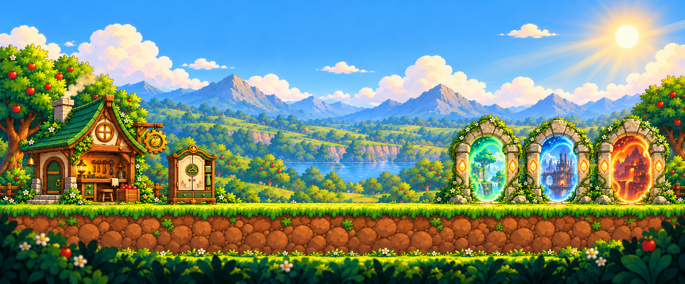

# Apple Meadow lobby visual target

A wide, side-view Trapple hub with a welcoming workshop on the left, a separate
wardrobe, a broad central movement space and three destination portals on the
right. The sun is in the upper-right corner, with warm rays traveling down-left.



## Deliverables

| File | Contents |
| --- | --- |
| `LobbyConcept.png` | Final 1942 × 809 RGB composition; the art-direction target. |
| `SceneryPlate.png` | Matching 1942 × 809 RGB scenery without stations or the foreground stone ground. |
| `InteractablesAtlas.png` | 1536 × 1024 RGBA cutouts: workshop, wardrobe and three portals. |
| `LayerLayout.json` | Measured placement guides, irregular atlas rectangles and proposed layer stack. |
| `GenerationPrompts.md` | Full generation/edit prompts and reference roles. |
| `Validation.md` | Visual and file checks, plus integration limits. |

These are concept and art-handoff assets. They live outside `Assets/` so review
does not alter the current Hub scene, import settings or runtime art. A playable
Unity scene, prefabs and colliders are not part of this deliverable.

## Foundation and visual identity

The primary references are the existing files in
`Assets/_Trapple/Art/AppleMeadow/Sources/`:

- `Sheet1.png`: bright leaf-shaped grass cap and rounded ochre stone soil.
- `Sheet2.png`: honey-colored wood, dark metal fittings and warm lanterns.
- `Sheet3.png`: apple trees, scalloped foliage, white daisies and clean silhouettes.
- `Sheet4.png`: warm crates, softened stones and natural material treatment.
- `Sheet6.png`: layered blue mountains, soft clouds and green landscape depth.
- `LevelReference.png`: side-view gameplay staging and the established smooth cartoon rendering.

`Assets/_Trapple/Art/Hub/Source/PixelHubReference.png` supplies the already approved
**designs** of the green-roof workshop, cream-door wardrobe and stone portals.
The new work follows Apple Meadow's smooth illustrated rendering. The forest,
factory and lava imagery stays inside the portals and indicates destinations;
it does not implement or unlock additional worlds.

All source files are preserved. Artwork was generated and edited with the
built-in image tool; no API/CLI fallback or third-party art pack was used.

## Composition and Unity placement

Coordinates in `LayerLayout.json` use top-left image pixels. The concept's level
walking line is approximately **y = 580**. All station foot anchors sit on that
line. Keep **x = 640–1245** clear for movement; this is approximately 31% of the
full width. The sun center is approximately **(1778, 102)**, or **(91.6%, 12.6%)**.

For an initial placement sketch, use 64 reference pixels per Unity unit, matching
the existing meadow ground convention. Set world origin to concept pixel
`(971, 580)`, then convert a concept point with:

```text
worldX = (imageX - 971) / 64
worldY = (580 - imageY) / 64
```

The resulting full hub spans about 30.34 units. This panoramic composition is
intended for a horizontal camera; on a 16:9 display, review the camera's framing
and scroll bounds rather than stretching the image. Pixel coordinates and
suggested sorting values are handoff guides, not verified runtime settings.

## Layer plan

| Layer | Suggested order | Contents / available material |
| --- | ---: | --- |
| Background | 0 | Sky, warm clouds, upper-right sun and restrained rays. |
| Far mountains | 10 | Desaturated blue peaks, guided by `Sources/Sheet6.png`. |
| Midground | 20 | Orchard hills, water and soft small trees. |
| Foreground | 30 | Side-framing apple trees behind the stations. |
| Ground | 40 | Continuous grass cap and soil face, using existing `Resources/AppleMeadow/Ground.png`. |
| Workshop | 50 | Independent workshop cutout from the atlas. |
| Wardrobe | 50 | Independent wardrobe cutout from the atlas. |
| Portals | 50 | Three independent arch cutouts from the atlas. |
| Decorative foreground | 70 | Low grass, flowers and bushes at the bottom and outer edges. |

The optional parallax ratios in the JSON are starting values for later
implementation. Keep all stations and ground in the same gameplay plane.
Existing `Tree.png`, `Bush.png`, `Grass.png` and `Flowers.png` under
`Assets/_Trapple/Resources/AppleMeadow/` supply reusable source-based decorations.
Do not add another tree over a tree already present in the scenery plate.

**Separation status:** the workshop, wardrobe and each portal have independent
alpha cutouts. Sky, mountains, hills and framing foliage are combined in
`SceneryPlate.png`; they are not delivered as separate parallax plates. The plate
also retains low edge foliage, which the gameplay ground can cover. Fully
independent scenery layers need extraction or repainting behind their silhouettes.
The source ground and decorative sprites are available in the existing project.

## Atlas slicing and material notes

Import a copy of the atlas only when integrating the approved art. Use Sprite
Multiple, Bilinear filtering, alpha transparency, no mipmaps, max size 2048 and
uncompressed textures during review. Do **not** slice this image into equal grid
cells: the workshop is wider than a single nominal cell. Use the five explicit
rectangles in `LayerLayout.json`; both image top-left and Unity bottom-left
coordinates are provided.

Set pivots to the supplied approximate foot anchors and fit each station to the
concept independently. The atlas normalizes objects for legibility, so one
shared scale does not reproduce their intended relative sizes. Generated
cutouts retain the designs but are not pixel-identical to the concept.

The atlas has genuine transparent gutters. Its maximum alpha is 254 rather than
255; solid areas are effectively opaque, but inspect edges over both light and
dark backgrounds during import. Portal destination images and glow are baked
inside each arch. Separate frame, interior, particles and emission textures
would be a later production pass. Keep future glow restrained and maintain the
right-side golden light direction on every station.

Place interaction triggers and collision shapes separately from the decorative
sprites. Keep foliage and station silhouettes out of the central walking lane.
No player, text, UI, HUD or stats are baked into the concept.
