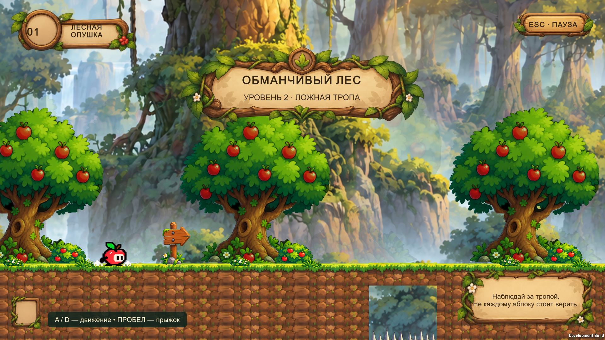
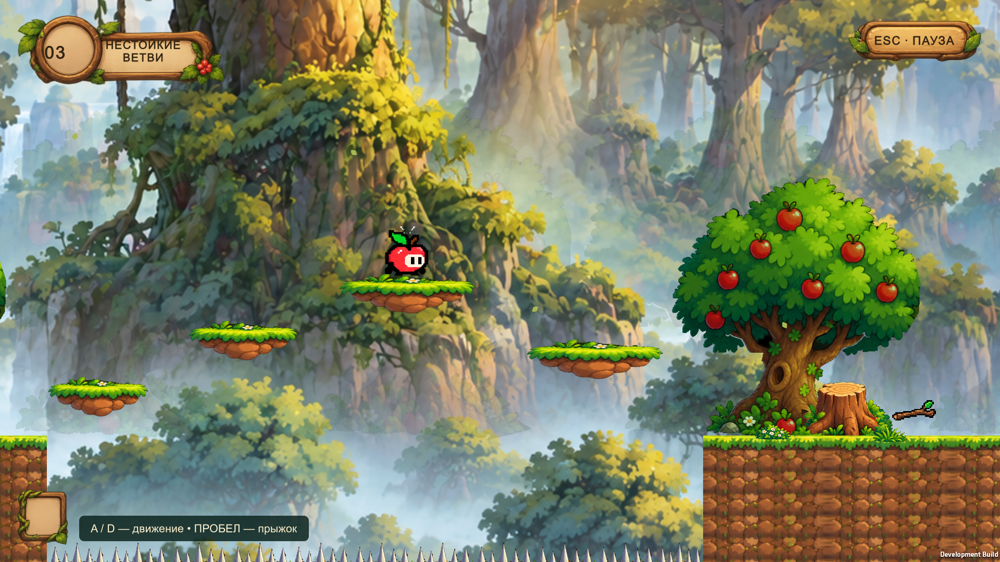
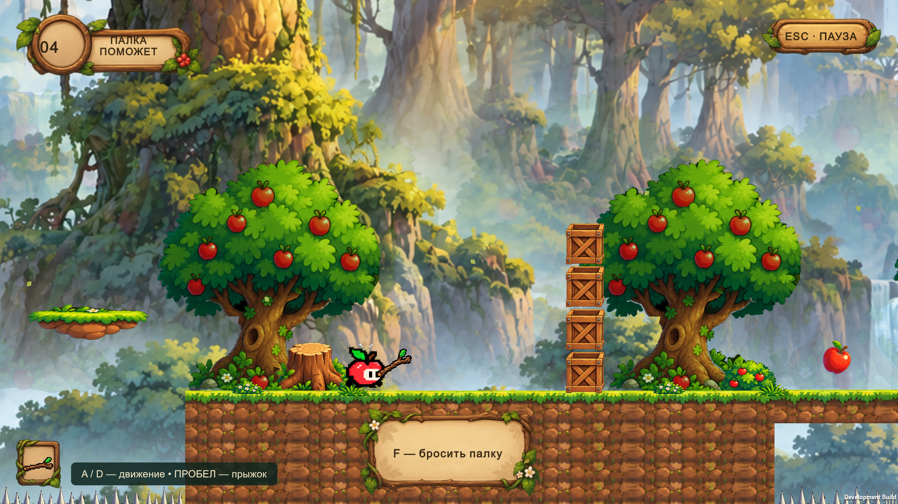
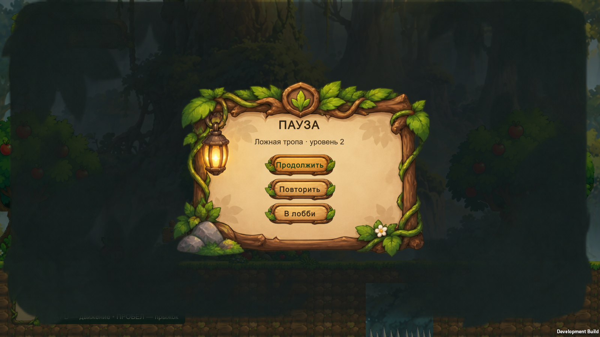
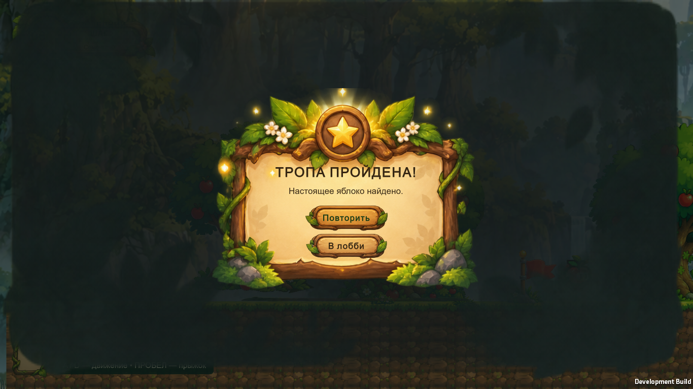
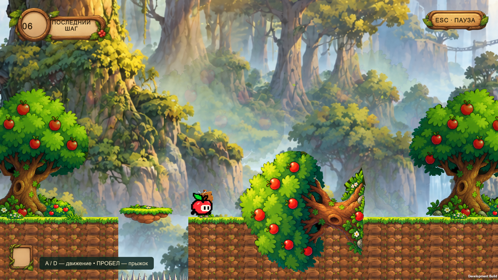

# Проверка Deceptive Forest — Level 2

Дата: 25 октября 2026. Unity **6000.6.0f1**, Windows x64, Built-In Render Pipeline.
Проверялся сохранённый Level 2, а не только отдельные компоненты.

## Результаты

| Проверка | Результат |
| --- | --- |
| Полный PlayMode suite | **66/66 passed**, включая 12 новых тестов леса |
| Полный EditMode suite | **28/28 passed** |
| Windows Development Build | **Succeeded** |
| Валидация сохранённой сцены через Unity API | Нет Missing Script, потерянных Sprite и неназначенных ссылок компонентов леса; один Appi и цель |
| Автоматическое прохождение всего маршрута | **Passed**, базовая физика, движение и прыжки PlayerController, без телепортации по маршруту |
| Сборка: UI и взаимодействия | **PASS**, завершение, повтор, смерть, возврат в Hub, палка, преграда, дерево |
| Разрешения | 1920×1080, 1600×900, 1366×768; для каждого сохранены вход, пауза и завершение |
| Логи финальной сборки при проверке | Нет Exception / Error / Warning в player.log |
| Нативная клавиатура Windows | Probe подтвердил Space и положительную вертикальную скорость; остальные действия не завершены, пользователь остановил Computer Use через Escape |

Unity работал в изолированной копии проекта, чтобы не менять открытую редакторскую
сессию. Сцена и префабы созданы и сериализованы Editor API; YAML вручную не генерировался.
Проверенная сцена, её новые `.meta` и ресурсы перенесены в рабочий проект.
Существующие сцены, префаб Appi, ассеты Apple Meadow и их GUID не изменены.

## Новые PlayMode-тесты

`Assets/_Trapple/Tests/PlayMode/DeceptiveForestTests.cs`:

1. `SavedSceneHasPlayerArtPrefabsAndSafeSpawn`: безопасная опора, один игрок, реальные спрайты, исходные физические параметры.
2. `FallingGroundOnlyActivatesOnTopAndWaits`: боковой контакт, контакт сверху, задержка и падение.
3. `DisappearingBranchRemovesArtAndSupportTogether`: предупреждение, одновременное отключение картинки и опоры.
4. `BaitDoesNotCompleteAndPitKills`: приманка не завершает уровень; яма вызывает смерть.
5. `DeathRestartsAndResetsTrapsItemsAndTime`: повторный Die, перезапуск, сброс ловушек, предмета и timeScale.
6. `StickRangePickupThrowBarrierAndHudWork`: радиус подбора, удержание, item slot, бросок и разрушение преграды.
7. `StickCanThrowLeftAndAlwaysRecoversAfterMiss`: левое направление, промах, автоматический возврат и повторный подбор.
8. `TreeWarnsRotatesKillsAndSettlesSafely`: предупреждение, поворот, смерть от движущегося ствола, безопасное конечное состояние.
9. `PauseUsesSharedManagerAndDoesNotSubmitFromGameplay`: заморозка, продолжение, отсутствие Submit из игрового HUD и очистка фокуса.
10. `GoalCompletesOnceAndReturnToHubPreservesSave`: финиш, блокировка игрока, UI-кнопка Hub, неизменность preview-save и блокировки леса.
11. `CameraStaysBoundedWhenPlayerFalls`: фиксированная высота и правая граница камеры.
12. `WholeLevelCanBeCompletedWithBaseMovementAndStick`: весь путь от spawn до настоящего яблока.

Полное прохождение подаёт направление и запрос прыжка в существующий PlayerController
и вызывает его FixedUpdate. Оно использует реальную 2D-физику и не увеличивает параметры
Appi. Остальные изолированные проверки иногда переставляют игрока непосредственно к
проверяемой ловушке. Это не ручное прохождение и не проверка всех возможных траекторий.
Остальные 54 PlayMode и 28 EditMode — существующие регрессионные тесты проекта.

## Визуальная проверка

Автоматический capture-runner получил 18 кадров из собранной игры. Осмотрены игровая
геометрия, Appi, палка, дерево, HUD, подсказки, смерть, пауза и завершение. По результатам
подсказка перенесена ниже игровых опор, уменьшен контраст дальних деревьев, исправлены
размещение текста HUD и интервалы внутри модальных панелей.

Кадры из финальной сборки:













## Воспроизведение

В Test Runner запустить EditMode и PlayMode. Для командной проверки закрыть Editor
этого проекта либо использовать отдельную копию Assets, Packages и ProjectSettings:

```powershell
$forestEditor = 'C:\Program Files\Unity\Hub\Editor\6000.6.0f1\Editor\Unity.exe'
$forestProject = (Get-Location).Path
& $forestEditor -batchmode -nographics -projectPath $forestProject -runTests -testPlatform PlayMode -testResults "$forestProject\Logs\forest-playmode.xml" -logFile "$forestProject\Logs\forest-playmode.log" | Out-Host
& $forestEditor -batchmode -nographics -projectPath $forestProject -runTests -testPlatform EditMode -testResults "$forestProject\Logs\forest-editmode.xml" -logFile "$forestProject\Logs\forest-editmode.log" | Out-Host
```

Сборка: **Trapple → Deceptive Forest → Build Windows Preview**.
Обычный запуск `Builds/DeceptiveForest/Trapple.exe` не включает диагностику.
Для автоматических кадров Development Build принимает `-forest-capture <каталог>`;
результат записывается в `result.txt`. Этот режим переставляет Appi между секциями
и проверяет UI/interactions, но не заменяет тест полного маршрута.
`-forest-keyboard-check <каталог>` — отдельная интерактивная диагностика Space,
Escape, Escape, Space, E, F; ожидаемая клавиша записывается в `waiting.txt`.
Оба режима отключены в Editor и обычной сборке без этих аргументов.

Локальные результаты сохранены в `Logs/DeceptiveForest/`: XML обеих полных тестовых
серий, журналы Unity, сборки и `FinalCaptures/`. Windows-сборка находится в
`Builds/DeceptiveForest/`. Эти каталоги исключены из Git; выбранные кадры сохранены
в этом документе для проверки PR.

## Ограничения

- Полного ручного прохождения человеком и полного нативного клавиатурного smoke-test не заявляем.
  Автоматические тесты проверяют маршрут и игровые контракты; они не оценивают субъективную сложность.
- Проверялись Windows x64 и три разрешения 16:9. Mobile, macOS, Linux, gamepad,
  ultrawide и производительность на слабом железе не проверены.
- Аудио и отдельные кадры удержания/броска Appi отсутствуют в предоставленных ресурсах.
  Палка отображается и движется отдельным спрайтом; уровень без звука.
- Уклонение, Level 1/3 леса, награды и production-прогрессия не реализовывались.
  В карте миров лес остаётся заблокированным; для Level 2 есть прямой запуск и отдельный профиль.
- Крона падающего дерева декоративная; опасен движущийся ствол, после падения он безопасен.
- UI kit содержит исходные полупрозрачные зелёные края. Они сохранены как часть оформления.
- Ветка основана на `952041c` из `feature/apple-meadow-lobby-integration` (PR #18),
  чтобы сохранить актуальные ассеты и лобби. До слияния PR #18 diff к main включает эту зависимость.
