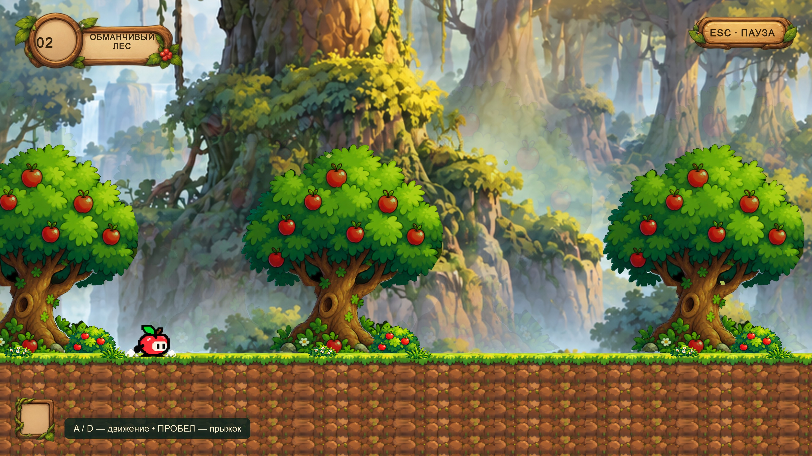
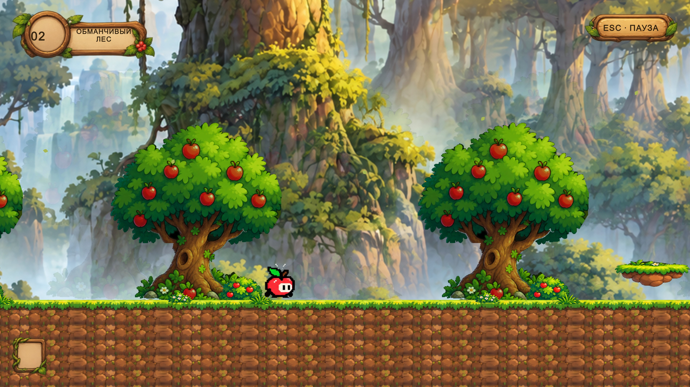
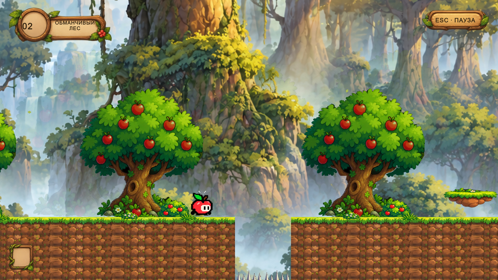
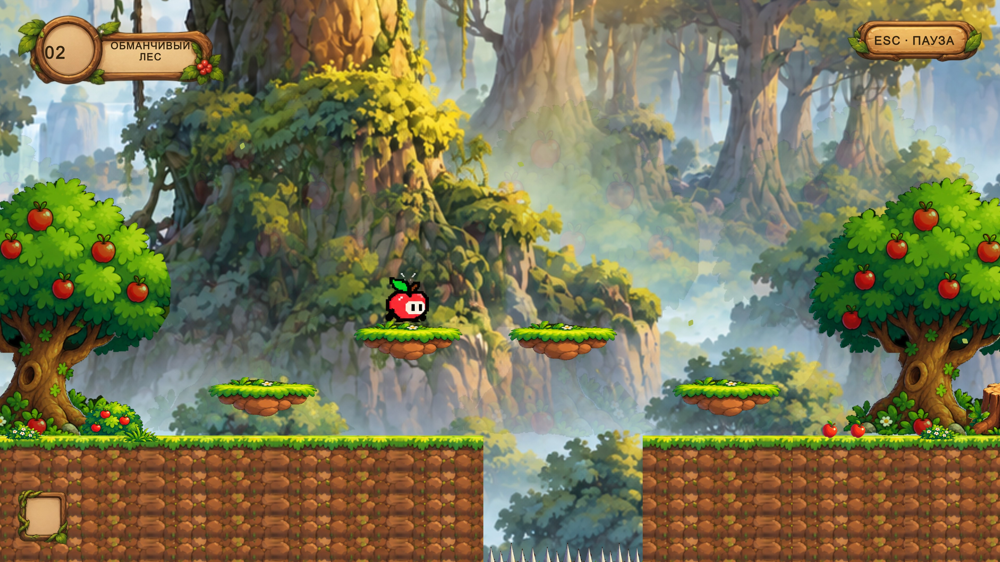
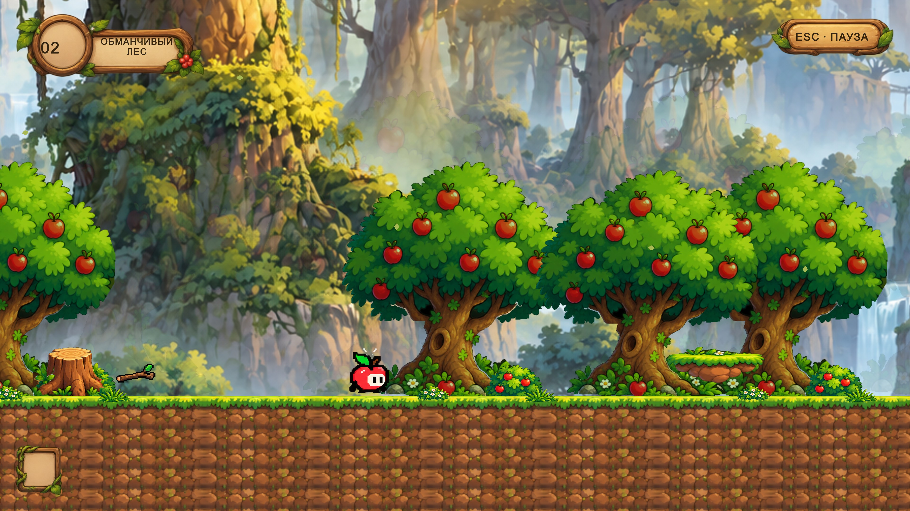
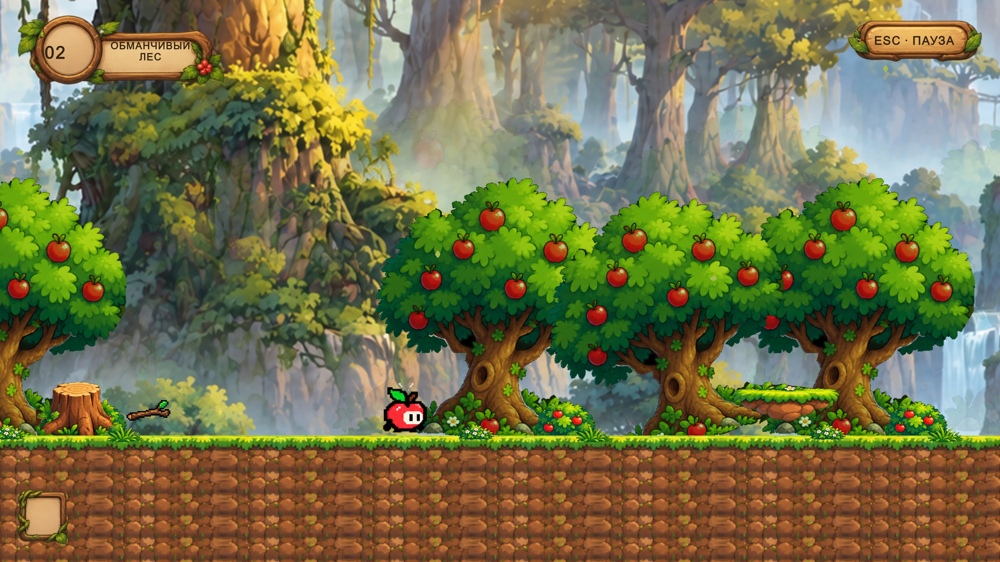
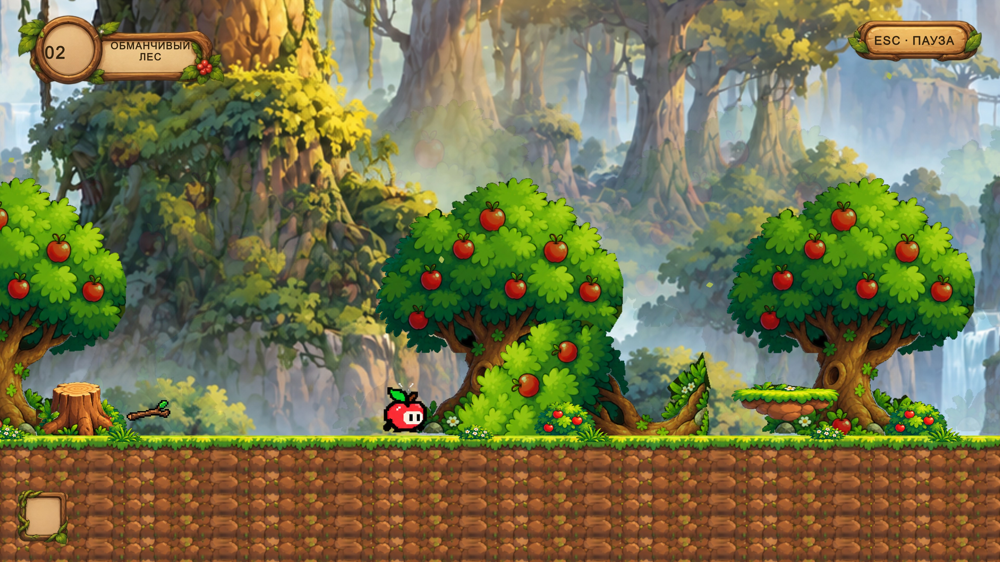

# Проверка переработки Deceptive Forest — Level 2

25 октября 2026. Unity 6000.6.0f1, Windows x64. Проверялась существующая сохранённая
сцена `Assets/_Trapple/Scenes/DeceptiveForest/DeceptiveForest_Level02.unity`.

## Результаты

| Проверка | Фактический результат |
| --- | --- |
| Полный Play Mode suite после перестройки и выравнивания деревьев | **70/70 passed**, включая 16 проверок леса и 54 регрессионные проверки |
| Полный Edit Mode suite | **28/28 passed** |
| Повторная проверка маскировки и HUD после последней правки переноса названия | **1/1 passed** |
| Полное прохождение от spawn до финиша | **Passed**: обычный PlayerController, реальная Physics2D, базовые скорость/прыжок, без телепортаций по маршруту |
| Unity API: сохранение, ссылки, Missing Script, Sprite, Appi, цель | **Passed** при миграции и финальной сборке |
| Windows Development Build финального исходного кода | **Succeeded**, Unity завершился с кодом 0 |
| Запуск отдельного Trapple.exe | **Не выполнен**: Windows Application Control заблокировал запуск файла |
| Графический Unity Editor Play Mode | Получены и осмотрены реальные кадры 3840×2160, 15 изображений |
| Проверки capture-runner | Игровые и UI-проверки без сообщений `FOREST CAPTURE`; общий `result.txt` — **FAILED** из-за внутреннего исключения Unity Search, см. ниже |
| Новые ошибки компиляции, Missing Script, NullReferenceException в тестах уровня | Не обнаружены |
| `git diff --check` | Passed |

Краткая машинная сводка: [ReworkChecks.json](ReworkChecks.json).
Полные локальные XML и журналы находятся в `Logs/DeceptiveForestRework/`, исключённом из Git.

Работа Unity выполнялась в изолированной копии проекта
`%TEMP%/TrappleForestRework-20261025`, чтобы не закрывать открытый пользовательский Editor.
Сцена и три префаба сериализованы Unity Editor API и перенесены обратно в рабочую копию.
Их прежние `.meta`/GUID сохранены. YAML вручную не генерировался.

## Проверенные игровые контракты

1. Безопасный spawn, один Appi, прежние размер collider, gravityScale и спрайты.
2. Четыре полностью скрытые ямы: совпадение грунта и высоты поверхности с безопасными сегментами.
3. Контакт сбоку не активирует первую поверхность; контакт сверху запускает единственный цикл.
4. До раскрытия работают опора и маскировка; после раскрытия нет опоры и появляются шипы.
5. Третья ветвь визуально идентична безопасной: весь декор исчезает вместе с collider.
6. Яблоко запускает обрушение по близости без необходимости приземляться; оно не завершает уровень.
7. Камера/декор/иной Rigidbody2D не активируют яблоко и деревья.
8. Дерево проходит ожидание, поворот, летальный контакт и безопасное конечное состояние.
9. Засада после прыжка ждёт приземления; пауза останавливает её физику.
10. Повторный Die запускает один restart; все шесть поверхностей и три дерева, палка и преграда восстанавливаются.
11. E/F работают с прежним радиусом, направлением броска, возвратом палки и разрушением барьера.
12. Подсказки предмета исчезают по времени и не возобновляются при повторном приближении.
13. Пауза использует общий GameManager, игровой Space не нажимает UI-кнопки.
14. Финиш срабатывает один раз, повтор работает; возврат в Hub не изменяет preview-save.
15. Камера сохраняет высоту и границы при падении.
16. Весь описанный маршрут проходим с базовой физикой без покупок и двойного прыжка.

Полное прохождение подаёт движение и запрос прыжка в существующий PlayerController.
Изолированные тесты переставляют Appi к проверяемому объекту. Capture-runner тоже
переставляет персонажа между секциями для кадров, но активацию первой ямы и дерева
проверяет настоящими физическими контактами. Это автоматизация, а не ручное прохождение.

## Реальные кадры Unity Play Mode

Изображения сняты с Game View в графическом Editor; это не концепт-арты и не изображения
из заблокированного Windows-player. После осмотра устранён зазор под основанием дерева
и добавлен явный перенос названия мира в HUD. Камера и персонаж сохранены.

Начальная дорожка и общий игровой вид:



Один и тот же участок до и после активации:





Визуально одинаковые опоры и естественно расположенные небольшие яблоки:



Дерево до активации, в движении и после падения:







Дополнительные проверенные кадры:
[яблоки](Images/Rework/apple-clearing.jpg),
[компактная подсказка](Images/Rework/stick-compact-hint.jpg),
[засада после прыжка](Images/Rework/landing-surprise.jpg),
[финальная комбинация](Images/Rework/final-combination.jpg),
[пауза](Images/Rework/3840x2160-pause.jpg),
[смерть](Images/Rework/death-retry.jpg),
[завершение](Images/Rework/3840x2160-complete.jpg),
[возврат в лобби](Images/Rework/hub-return.jpg).

## Ограничения и оставшиеся проблемы

- Windows Application Control запретил запуск собранного `.exe`. Политика не изменялась.
  Финальная сборка лежит в `Builds/DeceptiveForest`, но её запуск на этой машине не подтверждён.
- В графическом Editor воспроизводится `ArgumentOutOfRangeException` из
  `UnityEditor.Search.SearchDatabase.EnumerateAll` → `GetDefaultSearchDatabase` →
  `SearchInit.IndexationOnStartup`. Стек относится к встроенному индексатору Editor;
  в нём нет игровых скриптов. Поэтому строгий capture-runner вернул FAILED, хотя все
  его собственные проверки и весь отдельный Play Mode suite прошли. Ошибка не скрыта
  и исправление индексатора не включено в задачу уровня.
- Графический журнал также содержит диагностическое сообщение DX12 об увеличении
  upload buffer при захвате 4K. Кадры получены полностью; чистый графический лог не заявляется.
- Человек не проходил уровень целиком; субъективная сложность требует playtest.
  Проверен один полный маршрут и отдельные состояния, не все возможные траектории.
- В этой переработке визуально проверено 3840×2160. Другие разрешения, платформы,
  gamepad и производительность на слабом оборудовании повторно не проверялись.
- Крона падающего дерева декоративная; летален движущийся ствол. Звук и production-прогрессия
  леса отсутствовали раньше и здесь не добавлены. Карта миров сохраняет прежнюю блокировку леса.

## Воспроизведение

Для обычной игры открыть сохранённую сцену и нажать Play. Повторно применять миграцию не нужно.
Edit Mode и Play Mode доступны в Unity Test Runner. Командные тесты требуют закрытого
Editor этого проекта либо отдельной копии Assets, Packages и ProjectSettings:

```powershell
$forestEditor = 'C:\Program Files\Unity\Hub\Editor\6000.6.0f1\Editor\Unity.exe'
$forestProject = (Get-Location).Path
& $forestEditor -batchmode -nographics -projectPath $forestProject -runTests -testPlatform PlayMode -testResults "$forestProject\Logs\forest-playmode.xml" -logFile "$forestProject\Logs\forest-playmode.log"
& $forestEditor -batchmode -nographics -projectPath $forestProject -runTests -testPlatform EditMode -testResults "$forestProject\Logs\forest-editmode.xml" -logFile "$forestProject\Logs\forest-editmode.log"
```

Для воспроизведения кадров **в отдельном одноразовом Editor**, без `-batchmode` и
`-nographics`, использовать `-executeMethod Trapple.Editor.DeceptiveForestRework.CaptureInEditor`
и `-forest-capture <абсолютный-каталог>`. Runner снимает текущее разрешение Game View,
проверяет состояния и завершает этот процесс Editor. Обычный запуск без аргумента
не создаёт runner. Windows Development Player с тем же аргументом поддерживает
три тестовых разрешения, но этот вариант здесь заблокирован системой.
