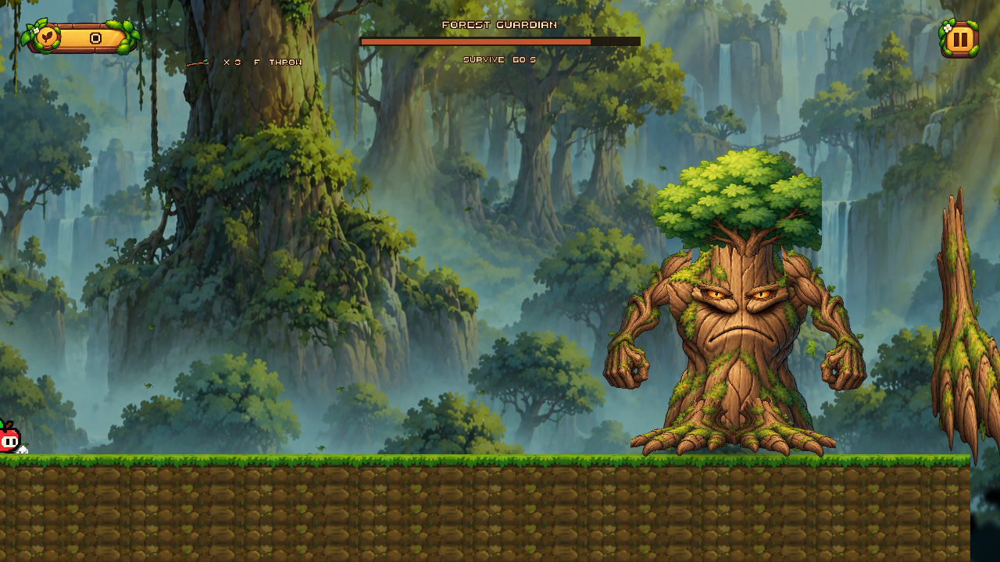
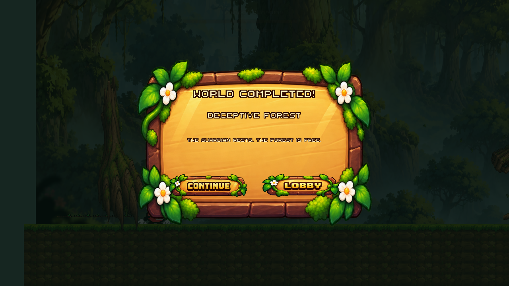

# Trapple: боссы и завершение миров

Обновление первого мира: вместо арены с рычагом в Tutorial теперь используется **Orchard Warden**, испытание на 45 секунд уклонения. Актуальное устройство и управление первого боя — [Docs/OrchardWarden/README.md](../OrchardWarden/README.md). Описание Ancient Tree с рычагом ниже отражает прежнюю интеграцию; этот прототип сохранён отдельно в BossTest. Второй босс и палки продолжают работать как описано далее.

Этот документ описывает интеграцию Ancient Tree в конец Apple Meadow и Forest Guardian в конец существующего Deceptive Forest. Основной маршрут, ловушки, управление Appi, мастерская, хаб и прежняя механика палок для открытия проходов сохраняются.

## 1. Основа проекта и границы изменения

Проект использует Unity **6000.6.0f1**, C#, встроенный Render Pipeline, `SpriteRenderer`, Physics2D, обычный Input Manager и интерфейс Storybook на uGUI/TextMeshPro. В проекте также остаются старые панели UI Toolkit. Для земли уже существует физический слой `Ground` с индексом 6; художественные слои разделяются существующим `sortingOrder`, новый Render Pipeline не вводится.

До интеграции уже существовали:

- `PlayerController`, `PlayerSpriteAnimator`, `PlayerDeath`: движение, отдельные кадры движения в обе стороны, прыжок, смерть.
- `GameManager`, `GameInterface`, `DeathScreenUI`: пауза, загрузка сцен, общий HUD, экран смерти и повторная попытка.
- `LevelCourse`: семь авторских секций расширенного маршрута в каждом из двух игровых миров.
- `TutorialGoal` и `ForestGoal`: прежнее немедленное завершение маршрута при достижении яблока.
- `AncientTree.prefab`, `BossTest.unity`, `BossController`, `BossAttack`, `BossPhaseController`, `ArenaLever`: первый босс со 100 HP, тремя атаками и рычагом E, наносящим 25 урона за окно уязвимости.
- `ForestStick` и `ForestStickTarget`: переносимая палка, которую подбирают через E и бросают через F для открытия лесных проходов.
- `HubSceneFlowController`, `PreviewProgressionService`, `PreviewSaveService`: единый источник сохранений, разблокировки миров, косметика и карта миров.

В конфигурации лес имел три запланированных уровня, но реально существует **одна непрерывная сцена**. Число уровней леса приведено к фактическому числу настроенных сцен, поэтому победа в ней завершает мир. Запланированные Factory и Lava не получают новые уровни в рамках этой задачи.

## 2. Какие сцены и префабы используются

| Путь относительно корня проекта | Роль |
|---|---|
| `Assets/_Trapple/Scenes/Levels/Tutorial.unity` | Прежний маршрут Apple Meadow и добавленная арена существующего Ancient Tree в конце |
| `Assets/_Trapple/Scenes/DeceptiveForest/DeceptiveForest_Level02.unity` | Прежний лесной маршрут, девять боевых палок, чекпоинт, арена Forest Guardian, HUD и вступление |
| `Assets/_Trapple/Scenes/BossArenas/ForestGuardianTest.unity` | Отдельная короткая сцена для работы с тем же лесным боссом и его префабами |
| `Assets/_Trapple/Scenes/BossArenas/BossTest.unity` | Прежняя изолированная сцена первого босса; остаётся для регрессионных проверок |
| `Assets/_Trapple/Prefabs/Bosses/AncientTree.prefab` | Существующий первый босс |
| `Assets/_Trapple/Prefabs/ForestGuardian/ForestGuardian.prefab` | Составной лесной босс с `BossHealth`, физическим коллайдером и анимированным ригом |
| `Assets/_Trapple/Prefabs/ForestGuardian/GuardianHazard.prefab` | Переиспользуемый физический объект для корней, ветки и летящих листьев |
| `Assets/_Trapple/Prefabs/ForestGuardian/StickPickup.prefab` | Автоматически подбираемая боевая палка |
| `Assets/_Trapple/Prefabs/ForestGuardian/StickProjectile.prefab` | Физический снаряд Appi |
| `Assets/_Trapple/Settings/HubConfiguration.asset` | Существующая общая конфигурация миров и сохранения |

Сцены и префабы сохраняются через Unity Editor API. Сборщик не создаёт YAML сцен вручную. Главный пункт меню: **Trapple → Boss progression → Build and integrate both worlds**, метод `Trapple.Editor.ForestGuardianBuilder.Build`. Он готовит ассеты, настраивает конфигурацию, подключает лесной бой и вызывает интеграцию Apple Meadow. Изолированный пункт первого босса: **Trapple → Boss Progression → Integrate meadow Ancient Tree**.

Пересборка предназначена для воспроизводимой интеграции. Перед запуском сохраните ручные изменения сцен. Сборщик леса пересоздаёт свою ветку `Forest Guardian Encounter` и принадлежащие ей компоненты; ручные правки внутри этой ветки нужно перенести в сборщик или префабы. Meadow-сборщик сохраняет уже существующую интеграцию первого босса.

## 3. Первый мир: прежний босс после маршрута

`MeadowBossBuilder` добавляет поляну после прежнего финиша, две существующие по смыслу платформы, рычаг, камень и границы арены. Дерево использует существующий префаб, прежние атаки, 100 HP и окна уязвимости. Бросания боевых палок в первом мире нет.

`TutorialGoal` теперь передаёт вход на арену в `MeadowBossEncounter`, не объявляя победу при одном касании яблока. Короткое вступление блокирует управление и плавно переводит камеру к арене. После вступления или Enter включается прежний `BossController`.

В этой интеграции у `BossController` выключен параметр `completeLevelOnDeath`: событие `FightFinished` сначала обрабатывает `MeadowBossEncounter`, затем сохраняет результат и завершает уровень через действующий `GameManager`. В прежней изолированной сцене стандартное поведение контроллера сохраняется.

## 4. Лес: последовательность состояний

`ForestGuardianEncounter` управляет всем путешествием от маршрута до итогового экрана:

1. **Route**: Appi проходит существующие препятствия и собирает палки. Босс не атакует.
2. **Intro**: после входного триггера на арене закрываются видимые корни, камера переводится на босса, управление блокируется, усиливаются движущиеся листья и играет короткий тревожный звук.
3. **BossFight**: вступление заканчивается, управление возвращается, открываются HP босса и отсчёт выживания.
4. **Resolving**: победа уже зафиксирована для текущего боя, атаки и снаряды очищены, проигрывается поражение или отступление.
5. **Complete**: результат записывается в существующее сохранение, появляется экран `WORLD COMPLETED! / DECEPTIVE FOREST`.
6. **Failed**: Appi погиб; используется существующий экран смерти и загрузка сцены для повторной попытки.

Входной `BossEncounterTrigger` вызывает `CaptureCheckpoint()` или `EnterArena()`. Повторный вход не запускает вступление второй раз. **Enter** вызывает тот же переход к бою, что и естественное окончание вступления, поэтому камера и управление получают конечное состояние одним путём.

`BossArenaCameraController` временно выключает обычный `ForestCamera`, плавно меняет положение и размер камеры и добавляет небольшую ограниченную тряску. Размер камеры на арене учитывает её ширину и соотношение сторон экрана. После боя или смерти управление камерой возвращается обычному следованию.

## 5. Forest Guardian: боевая логика

`ForestGuardianController` отвечает только за бой. Вступление, общий таймер и сохранение остаются у encounter-компонента. Используется существующий `BossHealth`, настроенный на **5 HP**, а не вторая независимая система здоровья.

Боевая машина состояний: `Inactive → Intro → Idle → PreparingAttack → Attacking → Recovering → Idle`. Попадание переводит в `Stunned`; конечные состояния — `Defeated` и `Retreating`. Попадание отменяет текущую атаку и её предупреждение: после реакции Hurt не может внезапно появиться опасность от прерванной атаки.

Атаки идут в понятном повторяющемся порядке:

| Атака | Предупреждение и зона | Как уклоняться |
|---|---|---|
| Root Strike | Жёлтая отметка в зафиксированной позиции игрока, затем корень из земли | Покинуть отмеченную позицию или перепрыгнуть удар |
| Branch Slam | Поднятие руки и отметка ограниченной ближней зоны слева от дерева | Выйти из ближней зоны или прыгнуть над низким ударом |
| Leaf Storm | Подготовка босса, затем низкие листья с постоянной горизонтальной скоростью и интервалами | Перепрыгивать предсказуемый поток |

Предупреждения не наносят урон. `ForestGuardianHazard` вооружается только при запуске атаки, вызывает существующий `PlayerDeath.Die()` и отключается после одного успешного контакта. Восемь заранее созданных объектов обслуживают корни, ветку и листья; во время боя объекты не создаются бесконечно. Смерть игрока, победа или отключение контроллера очищают все активные опасности.

## 6. Девять анимационных состояний и графика

Новый босс собран из прозрачных частей `GuardianKit.png`, созданного встроенным генератором изображений. Исходный лист, его происхождение и точный английский промпт описаны в [ArtPrompt.md](ArtPrompt.md). Случайные изображения из интернета не используются.

В `Assets/_Trapple/Art/ForestGuardian/` находятся исходный лист, спрайты `Torso`, `Crown`, `Arm`, `Root`, `Eyes`, `Leaf`, программная мягкая контактная тень, короткий звук подбора и тревожный звук появления. Один рисунок руки и один рисунок корня используются зеркально для обеих сторон. Текстура коры, крона, глаза и конечности остаются отдельными слоями рига.

`ForestGuardianAnimation` выполняет процедурную анимацию отдельных Transform с плавным экспоненциальным смешиванием. Отдельный Animator Controller для дерева не нужен; это самостоятельная подходящая архитектура анимации составного спрайтового персонажа.

| Состояние | Визуальное действие |
|---|---|
| Idle | Спокойный корпус, опущенные руки, почти закрытые глаза |
| Intro | Подъём корпуса, раскрытие глаз, подъём ветвей, переход к стойке |
| Combat Idle | Непрерывное покачивание, перенос веса, небольшое движение корней и рук, моргание |
| Windup | Отвод корпуса и подготовка руки в зависимости от выбранной атаки |
| Attack | Удар рукой, движение корней или жест выпуска листьев |
| Hurt | Короткая отдача корпуса, прищур и светлая вспышка |
| Angry | Усиленная стойка при HP не выше 40%, более напряжённые руки и глаза |
| Death | Потеря равновесия, опускание корпуса и ветвей, закрытие глаз |
| Retreat | Усталое отступление/засыпание с опусканием рук и остановкой корней |

Основной физический коллайдер остаётся на корневом объекте босса; движения художественных деталей невелики. Для атак используются собственные коллайдеры с явными размерами. `GuardianLeaves` переиспользует фиксированный набор декоративных листьев; при вступлении их горизонтальное движение ускоряется.

## 7. Два вида палок и управление

| Действие | Кнопка/условие |
|---|---|
| Движение | A/D или стрелки |
| Прыжок | Пробел |
| Ускорение | Левый Shift |
| Подбор прежней палки для проходов | E рядом с `ForestStick` |
| Бросок прежней переносимой палки | F, пока она в руках |
| Подбор боевого запаса | Автоматически при касании `StickPickup` |
| Бросок боевой палки | F, если прежняя палка не находится в руках и запас больше нуля |
| Пропуск вступления | Enter |
| Пауза | Escape |

Прежние `ForestStick` и `ForestStickTarget` продолжают открывать проходы. Новый `StickThrowController` выполняет обработку раньше `ForestStick`, замечает переносимую палку и отдаёт ей приоритет. Одно нажатие F не тратит одновременно палку головоломки и боеприпас.

`StickPickup` имеет триггер и отдельный `SpriteRenderer`. Подбор сначала проверяет живого управляемого игрока и вместимость, затем один раз увеличивает `StickInventory`, отключает коллайдер, проигрывает звук и короткое исчезновение вверх. Повторные физические события не дают дополнительный предмет. При полном инвентаре предмет остаётся на месте.

`StickThrowController` берёт снаряд из пула, запускает его с заданными силой, углом, гравитацией и вращением и только после успешного запуска тратит единицу запаса. Нельзя бросать при пустом инвентаре, паузе, смерти, блокировке управления или незавершённом cooldown. Направление учитывает `PlayerSpriteAnimator.State`: у готовых кадров WalkLeft/RunLeft `flipX` может быть выключен, поэтому одного значения `flipX` недостаточно.

`StickProjectile` использует Dynamic Rigidbody2D, BoxCollider2D, Continuous collision detection и игнорирование коллайдеров владельца. Одно попадание фиксируется **до** уведомления здоровья, что защищает от нескольких коллайдеров и повторных событий. При попадании он кратко вспыхивает/исчезает и возвращается в пул; промах также имеет ограниченное время жизни. Дополнительный дочерний визуальный элемент у Appi выполняет короткое движение броска, не заменяя кадры бега и прыжков.

## 8. Прогресс маршрута и HUD

`WorldProgressController` хранит упорядоченную ломаную `route`, предварительно считает длины её отрезков и проецирует положение Appi на ближайший отрезок. Прогресс равен пройденной длине вдоль линии, делённой на её полную длину. Уже достигнутое значение не уменьшается при небольшом возвращении назад; `ReachArena()` устанавливает 100%.

Текущий Deceptive Forest — одна преимущественно горизонтальная сцена, поэтому сборщик использует границы её семи секций как точки маршрута. Сам компонент поддерживает вертикальные и возвращающиеся участки: для такого уровня нужно вручную задать соответствующие точки `route`.

`ForestEncounterHUD` плавно показывает прогресс, коротко подсвечивает отметки 25/50/75/100% и пульсирует значком босса возле конца пути. Вступление освобождает верхнюю область для HP и таймера. Счётчик палок плавно догоняет фактический запас. Пауза и смерть скрывают боевой HUD, оставляя действующие общие панели.

## 9. Чекпоинт, смерть и повторная попытка

Перед ареной сохраняется снимок текущей попытки: путь сцены, количество боевых палок и набор ID уже подобранных предметов. Это временные данные игрового сеанса, не дополнительный файл сохранения.

При смерти используется существующий экран смерти. Его Retry заново загружает ту же сцену. Новый encounter узнаёт свой снимок, ставит Appi перед ареной, устанавливает запас **через Restore, а не повторное добавление**, а ранее собранные предметы скрывает через `MarkCollected()`. HP босса, атаки, таймер и камера создаются заново вместе со сценой. Повторное пересечение чекпоинта не перезаписывает исходный запас уже начатой попытки.

Это исключает дублирование предметов через Retry и сохраняет исходный шанс победить палками. Возвращение в другую сцену, выход в хаб и успешное завершение очищают временный снимок. После перезапуска приложения новая попытка начинается с маршрута; долговременно сохраняется завершение мира, а не незавершённый бой.

## 10. Два условия победы и сохранение

Первая победа — пять успешных попаданий по боссу с исходными настройками 5 HP и 1 урон. Вторая — выжить **60 секунд активного BossFight**. Отсчёт начинается после вступления, использует `Time.deltaTime` и дополнительно проверяет `GameManager.State == Playing`. Пауза, вступление, загрузка и смерть не приближают победу.

По HP запускается Death; по времени — Retreat. Оба варианта идут в единую последовательность Resolving, затем Complete. Пока Appi мёртв, победа не засчитывается; конечный результат защищён от повторных вызовов.

`WorldCompletion.Record()` обращается к прежнему `PreviewProgressionService`: записывает уровень, затем босса; для meadow также вызывает прежнее идемпотентное завершение обучения. Используется существующий ключ PlayerPrefs **`Trapple.HubPreview.v1`**, сохраняющий версии данных, валюту и косметику. Новое параллельное сохранение не создаётся.

`WorldCompletion` с сериализованной ссылкой на `HubConfiguration` позволяет сохранять результат и при прямом запуске сцены в редакторе. Когда затем загружается хаб, прежний `HubSceneFlowController` принимает недостающие ссылки на его UI. Карты и карточки миров используют общий `IsWorldComplete`, а завершённый лес получает зелёную отметку.

Continue выбирает доступный следующий игровой контент; при отсутствии настроенной следующей сцены возвращает в хаб. После леса Factory может стать разблокированным по сохранению, но запускать его нельзя, пока в конфигурации нет реальной доступной сцены. Кнопка Go to Hub всегда возвращает через существующую загрузку сцен.

## 11. Настройка через Inspector

| Компонент | Основные поля |
|---|---|
| `BossHealth` лесного префаба | `maximumHealth = 5` |
| `ForestGuardianController` | `minimumAttackInterval = 1.5`, `maximumAttackInterval = 3`, `warningDuration = 1.05`, длительности корня/удара, `leafSpeed = 6`, число и интервал волн, время Hurt; риг, предупреждение, префаб и спрайты атак |
| `ForestGuardianAnimation` | Ссылки на корпус, обе руки, оба корня, глаза; `stanceSpeed`, `swayAmount`, `blendSpeed` |
| `ForestGuardianEncounter` | Ссылки на игрока/босса/HUD-зависимости, границы арены, позиция чекпоинта, `survivalTime = 60`, `introDuration = 5`, `resolutionDuration = 2.6`, `skipKey`, звук появления |
| `StickInventory` | `maximumCapacity = 10` |
| `StickPickup` | Уникальный `pickupId`, `amount`, `artwork`, `pickupSound` |
| `StickThrowController` | `throwKey = F`, `throwForce = 12`, `throwAngle = 10`, `gravityScale = 0.65`, `damage = 1`, `cooldown = 0.35`, `poolCapacity = 6`, ссылки на инвентарь/снаряд/визуальную руку |
| `StickProjectile` | `artwork`, `lifetime = 4` |
| `WorldProgressController` | `player`, упорядоченные точки `route` |
| `BossArenaCameraController` | Прежний follow-компонент, `smoothTime` |
| `BossEncounterTrigger` | Encounter и признак чекпоинта |
| `WorldCompletion` | Действующая `HubConfiguration` |
| `MeadowBossEncounter` | Первый босс, цель, игрок, камера/следование, граница, длительности вступления и завершения |

Не увеличивайте скорость листьев и не сокращайте предупреждение без проверки реальной высоты прыжка и размеров арены. Сначала проверьте базовый баланс с новым игроком, затем меняйте параметры.

## 12. Созданные исходники

Новые игровые компоненты находятся в `Scripts/Bosses/` (`ForestGuardianController`, `ForestGuardianAnimation`, `ForestGuardianHazard`), `Scripts/DeceptiveForest/` (`ForestGuardianEncounter`, `BossEncounterTrigger`, `BossArenaCameraController`, `ForestEncounterHUD`, `GuardianLeaves`, `WorldProgressController`, четыре компонента Stick) и `Scripts/Level/` (`MeadowBossEncounter`, `WorldCompletion`).

Сборка выполняется через `Editor/ForestGuardianBuilder.cs`, `Editor/MeadowBossBuilder.cs`, `Editor/WorldCompletionSetup.cs`. Узкие изменения в `TutorialGoal`, существующем `BossController`, `GameInterface`, `HubSceneFlowController` и трёх вариантах UI карты нужны для включения прежних механизмов в новый порядок прохождения.

Автоматизированные проверки добавлены в `StickCombatTests`, `ForestGuardianCombatTests`, `MeadowBossEncounterTests`, `WorldCompletionProgressTests` и проверки encounter-сценариев. Фактические результаты запуска должны браться из Unity Test Runner/XML текущей проверки. Наличие теста в репозитории само по себе не означает, что он прошёл.

## 13. Как проверить вручную

1. Открыть проект нужной версией Unity, дождаться импорта и убедиться, что Console не содержит ошибок компиляции. Если нужна пересборка, запустить главное меню интеграции.
2. Из хаба открыть карту, запустить Apple Meadow и пройти **весь маршрут**. До финальной арены первый босс не должен атаковать. Проверить вступление, Enter, прежний рычаг E, все три прежние атаки, победу и переход к доступному лесу.
3. Запустить лес из хаба. Проверить положение верхнего прогресс-бара, шкалу 25/50/75%, счётчик и отсутствие конфликта с паузой и предметом в руках.
4. Подобрать одну и несколько боевых палок касанием. Повторное пересечение одного предмета не должно добавлять запас. Проверить вместимость 10 и невозможность получить отрицательный запас.
5. Проверить F вправо и влево из стойки, ходьбы, бега и прыжка; затем F с нулевым запасом. Отдельно проверить прежний цикл E → переносимая палка → F → открытый проход: боевой запас при таком броске не расходуется.
6. Пройти существующие ловушки и дойти до чекпоинта. Войти на арену; проверить закрытие видимых корней, камеру, листья, название и подзаголовок, возврат управления через 5 секунд. Повторить с Enter и с паузой во вступлении.
7. В бою наблюдать Root Strike, Branch Slam и Leaf Storm. Каждая атака должна сначала предупреждать, затем наносить урон только своей опасной областью. Проверить уклонение без специальных инструментов.
8. Попасть пять раз палками: HP плавно уменьшаются, Hurt прерывает атаку, проигрывается Death и появляется итоговый экран один раз.
9. В отдельной попытке израсходовать весь запас и прожить 60 секунд: появляется Retreat и тот же экран завершения. Поставить паузу на несколько секунд и убедиться, что время не уменьшилось.
10. Погибнуть во время боя. Через существующий экран смерти повторить попытку: Appi стоит перед ареной, количество палок равно снимку, собранные предметы не появились повторно, босс имеет полное HP, таймер снова равен 60. Повторить несколько раз.
11. После победы проверить Continue и Go to Hub. В карте лес должен иметь отметку завершения. Перезапустить Play Mode/приложение и проверить сохранение результата, валюты и косметики.
12. Отдельно открыть `ForestGuardianTest.unity` для быстрой настройки рига/атак и `BossTest.unity` для регрессии первого босса. После каждого сценария проверить Console.

Автотесты запускаются через **Window → General → Test Runner**, отдельно EditMode и PlayMode. Для проверки полного приключения необходим ручной проход маршрута; тесты отдельных состояний и коллизий не оценивают понятность ловушек и художественную читаемость.

## 14. Ограничения и работа после проверки

- Factory и Lava остаются запланированными мирами без новых сцен. Открытая запись в карте не означает наличие готового игрового уровня.
- Чекпоинт действует в текущем сеансе и при Retry той же сцены; незавершённый бой не сохраняется на диск.
- Ломаная прогресса подходит для текущего маршрута. В местах пересечения или полного наложения путей ближайшая проекция может быть неоднозначной; для такой будущей геометрии нужны явные последовательные route gates. Сейчас действует выбор более раннего отрезка при равной дистанции.
- Новая графика — составной спрайтовый риг с процедурными движениями. Это не комплект покадровых нарисованных вручную атак. Голос, полноценная музыка и дополнительные звуковые слои боя в эту реализацию не входят.
- Стартовые 5 HP / 9 палок / 60 секунд требуют ручной проверки с новым игроком на полном маршруте. Автоматические проверки не заменяют оценку сложности и восприятия вступления.
- При возврате в хаб страницы карты и гардероба вписываются по обеим осям CanvasScaler (Expand), поэтому кнопка закрытия остаётся доступной при 4:3.

## 15. Результаты проверки текущей реализации

Фактические результаты Unity, повторных прогонов, сборки и границы автоматической проверки собраны в [Validation.md](Validation.md). Полный список изменённых файлов — [ChangedFiles.md](ChangedFiles.md). Точный исходный prompt графики — [ArtPrompt.md](ArtPrompt.md).

Листья выпускаются тремя волнами с интервалом 0,4 секунды: такая длительность позволяет перепрыгнуть поток обычным движением Appi. Перед следующим предупреждением старые опасные объекты очищаются. При обоих вариантах победы часть заранее созданных декоративных листьев образует короткий выброс возле кроны; новые объекты для эффекта не создаются.

Пресет ForestGuardian хранится в начале координат; расположение босса на финальной арене задаётся экземпляром в сцене. Графика и параметры остаются доступными через Prefab Mode и Inspector.
