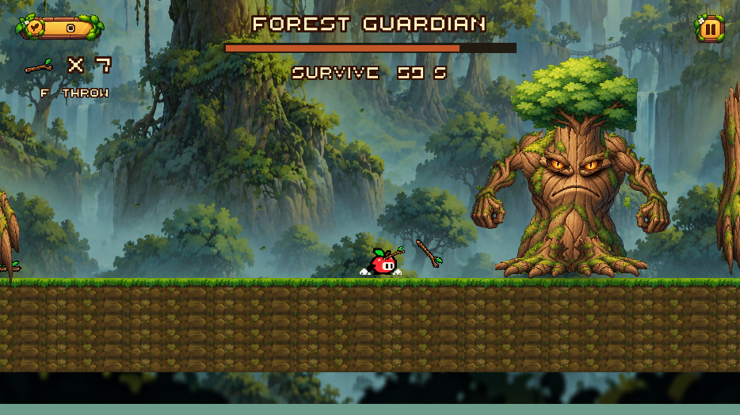

# Размер палок и читаемость Forest HUD

Исправление жалобы на маленькие палки на земле, огромный снаряд при броске и мелкий текст. Рабочая папка остаётся `C:\Users\zdeat\.codex\worktrees\forest-guardian\Trapple`, ветка `fix/guardian-stick-scale-and-hud`.

## Что изменено

- Палка на земле: рисунок увеличен с 0,7×0,22 до **1,25×0,65** игровых единиц. Он больше не сплющен; автоматический подбор сохраняется.
- Летящая палка: прежний root scale 0,5 превращал исходный спрайт 15,36×10,24 единиц в изображение 7,68×5,12. Теперь Rigidbody2D находится на корне с scale 1, а отдельный дочерний рисунок нормализован до **1,25×0,65**. Коллайдер задаётся независимо в игровых единицах.
- При попадании кратко увеличивается только рисунок, максимум на 12%. Повторный запуск возвращает исходный размер; физический объект не масштабируется.
- Сохраняется совместимость со старым prefab с SpriteRenderer на корне: компонент выделяет рисунок в дочерний объект и нормализует его перед использованием.
- Рисунок палки возле руки увеличен до 0,85×0,44.
- Шрифт маршрута: **24 → 72**, название босса **32 → 88**, таймер **25 → 72**, запас **26 → 88**. Подсказка F THROW имеет отдельную строку размера 50. Общий Storybook HUD не масштабируется.
- Поля надписей и полосок расширены. Проверяется также строка прогресса `100%` и двузначный запас `x 10`.

У шрифта Thaleah высота заглавной буквы составляет 28/64 от номинального размера, поэтому прежние значения давали лишь около 5–7 видимых пикселей на окне пользователя. Новые основные надписи дают не менее 14 пикселей на 934×524.

## Подключение

Изменены существующие `StickPickup.prefab`, `StickProjectile.prefab`, `DeceptiveForest_Level02.unity` и `ForestGuardianTest.unity`. HUD обновлён в обеих сценах через Unity Editor API. Маршрут и логика боя сохраняются.

Пункт меню **Trapple → Boss progression → Fix stick sizes and enlarge forest HUD**, метод `ForestGuardianBuilder.ApplyReadabilityFix`, повторяет только эту миграцию. Полный сборщик также использует исправленные размеры.

Основные изменённые файлы:

- `Editor/ForestGuardianBuilder.cs`.
- `Scripts/DeceptiveForest/StickProjectile.cs` и `ForestEncounterHUD.cs`.
- `Prefabs/ForestGuardian/StickPickup.prefab` и `StickProjectile.prefab`.
- `Scenes/DeceptiveForest/DeceptiveForest_Level02.unity` и `Scenes/BossArenas/ForestGuardianTest.unity`.
- `Tests/PlayMode/GuardianPresentationTests.cs` и `ForestGuardianVisualTests.cs`.

## Проверка

Unity 6000.6.0f1: **28/28 PlayMode passed**, 0 failed, 0 skipped. Windows x64 Development пересобрана: **Build Finished, Result: Success**, exit 0; локальный EXE — `Builds/Hub/Trapple.exe`. Проверка `git diff --check` пройдена. Сводка сценариев — [ReadabilityTestResults.json](ReadabilityTestResults.json).

Новые тесты используют настоящий сохранённый prefab со спрайтом, проверяют его полёт в обе стороны, вращение, удар и повторные запуски того же экземпляра. Отдельно проверяются размеры всех предметов на маршруте, поля текста, отсутствие пересечения счётчика с полосами и читаемость при 934×524 и 1280×720. Прежние проверки бросков, урона, трёх атак, чекпоинта и двух побед запускаются вместе с ними.

Снимки Unity с GPU, включая Canvas, сохранены в `ReadabilityImages/`. Они показывают маршрут, палки перед ареной, вступление, бой, реальную летящую палку и победу. Длинные маршруты повторно не проходились: геометрия маршрута не менялась. Оценка удобства физической клавиатуры остаётся ручной проверкой.

