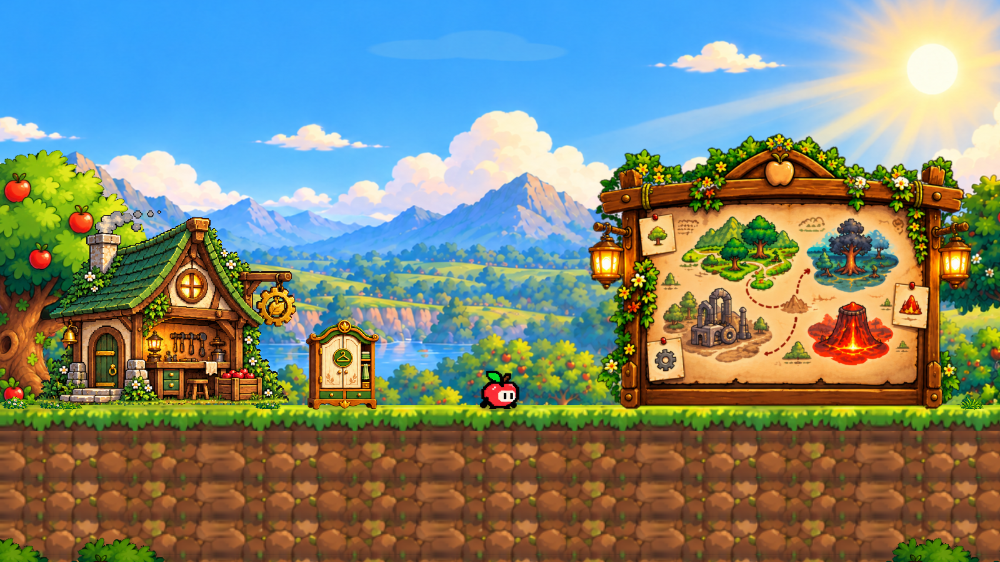

# Living Environment System — Hub

## Actual project and scope

Inspected and integrated with Unity **6000.6.0f1**, **Built-in Render Pipeline**.
`GraphicsSettings` and every quality tier have no pipeline asset; the package
manifest has no URP. No renderer migration, package installation, Light2D,
post-processing, new normal maps, gameplay or UI changes are needed.

Only `Assets/_Trapple/Scenes/Hub/Hub.unity` is integrated. `TrappleUI.unity`, levels,
player prefabs, workshop prefabs, progression and world-map data are unchanged.
The installer opens the existing Hub and uses Unity's serialization APIs; it
does not rebuild the Hub or write scene/prefab YAML. It refuses unsaved open scenes
and Play Mode. Run **Trapple → Hub → Install Living Environment** only to reinstall;
the committed Hub is already configured.

For an already-open Hub, **Trapple → Hub → Refresh Wind and Shadow Visibility**
updates just the visual settings and the reusable system prefab through Unity's
APIs. It preserves the current scene layout and checks collider invariants. Stop
Play Mode and refresh Assets first when changing scripts externally.

The scene audit found one orthographic camera (size 6.8), one `Default` sorting
layer, the existing `HubCameraController`, `PlayerController`,
`PlayerSpriteAnimator`, workshop transitions and map interactions. Existing
`HubAmbience` scenery objects are inactive; the replacement does not reactivate
them or compete with them. The active plants have tight meshes (9–44 vertices),
so wind uses fragment UV displacement instead of bending their sparse geometry.

## Installed effects

| Effect | Actual objects / behavior |
| --- | --- |
| Wind | Existing `Apple tree frame`, four `Meadow flowers`, four `Low foreground foliage`, plus four small independent grass tufts from the existing meadow sprite. All 13 share `FoliageWind.mat`. |
| Fixed bases | Grass/flowers/bushes pin their lower pixels. Tree wind starts above normalized height 0.62, leaving trunk and ground decoration fixed. No transform animation or collision changes. |
| Phase | Position-derived phase per plant, supplied through a cached `MaterialPropertyBlock`; no per-renderer material instances. |
| Clouds | Three separate, existing `Cloud.png` sprites; camera-relative parallax after camera follow plus slow independent horizontal drift. Wrap occurs outside the Hub and workshop camera ranges. |
| Water | Very small brightness ripples strictly inside a measured lake interior rectangle in `SceneryPlate.png` (UV 0.451, 0.391, 0.112, 0.023). Texture coordinates and the scenery transform remain unchanged. |
| Leaves | Two sparse emitters at the framing trees; intervals 4–8 / 6–11 seconds, capacities 3 / 2. No constant leaf rain. |
| Pollen | Two subtle clusters near vegetation; capacities 4 each, intervals 2–4 / 2.5–4 seconds. |
| Smoke | Three pooled, soft puffs above the cottage's already-painted chimney smoke; interval 2.5–4 seconds. |
| Warmth | Two faint sprite halos registered to the real cottage canvas: lantern and round window. Continuous, bounded sine variation, no random flashes. Built-in unlit artwork keeps its existing bright daytime shading. |
| Appi shadow | Separate world-space sprite, sorted one order below Appi. Physics2D selects the nearest non-trigger upward-facing Ground surface beneath the capsule feet. Jump height changes opacity and ellipse shape. |
| Ledges | The shadow footprint samples the hit surface and shrinks at unsupported edges. It hides when there is no support, Appi is hidden, or workshop cinematics suspend his rigidbody. Trigger zones and Appi's own rigidbody are excluded. |
| Static shadows | Soft green-brown ellipses under cottage, tree, wardrobe and map. Installed against the actual ground collider, above terrain (order 2) and below stations. |

The particle pools contain **16 sprites total**, instantiated once on startup.
Emission and animation reuse those objects. A private seeded RNG leaves gameplay
random state untouched. Updates use value types and fixed physics hit arrays;
there is no `Instantiate`, `Destroy`, LINQ, material cloning or collection growth
in the effect update loops. Motion uses scaled elapsed time / delta time, so
visuals pause with the game. Parallax also responds to camera motion.

## Inspector controls

Select **Living Environment** in Hub:

- `LivingEnvironmentController`: independent Wind, Clouds, Particles, Warm Lights,
  Contact Shadows and Water Shimmer switches; serialized references to every
  installed component. Disabling the component disables its effects. Runtime
  `SetEffectsEnabled(bool)` controls all categories without changing game settings.
- `EnvironmentWindController` on each plant: Speed, Strength (sprite-relative UV),
  Frequency, Phase and Fixed Base. The shader anchors the base and eases UV motion
  to zero at the left/right edges. These materials are for unatlased sprites;
  rotation/tight packing in a future Sprite Atlas would need a corresponding
  UV-space implementation before reuse.
  Scene strengths are 0.018 for the tree, 0.016 for bushes, 0.03 for flowers and
  0.035 for grass. The base mask is applied once; squaring it previously reduced
  most canopy movement below a visible pixel at the Hub camera scale.
- `ParallaxLayer` on each cloud: camera reference, Depth, Drift, Wrap Width.
  Depth 0 is infinitely distant and compensates camera movement fully; 1 is the
  gameplay plane. Distant objects consequently move less on screen.
- `AmbientParticleController`: Kind, particle prefab, Capacity (1–16), Region,
  Interval, Lifetime, Velocity, Flutter, Opacity and Seed. Configure pool capacity
  before entering Play Mode; changing capacity does not resize a running pool.
- `LightFlicker2D`: Intensity, Variation, Speed, Phase. This is an artistic sprite
  halo for the current Built-in scene, not a physical light/normal-map system.
- `AppiGroundShadow`: capsule and art references, Ground Layers, Max Distance,
  ground/air sizes and opacities, Fade Height and Surface Offset. The ray starts
  just above the feet so slightly embedded contacts still resolve correctly.
  The contact material supplies a broad, soft ellipse instead of reusing the
  lantern glow's rapidly fading alpha. Ground size is 1.25 × 0.23 units with
  opacity 0.44; airborne size is 0.85 × 0.29 with opacity 0.09.
- `EnvironmentWaterShimmer` on `Apple Meadow scenery`: Strength and Speed.
  `LakeShimmer.mat` exposes the conservative water UV rectangle.

## Source files and serialized artifacts

Runtime scripts in `Assets/_Trapple/Scripts/Hub/Environment/`:

- `EnvironmentWindController.cs`
- `ParallaxLayer.cs`
- `AmbientParticleController.cs`
- `LightFlicker2D.cs`
- `AppiGroundShadow.cs`
- `EnvironmentWaterShimmer.cs`
- `LivingEnvironmentController.cs`

Shaders: `Assets/_Trapple/Shaders/EnvironmentWind.shader`,
`EnvironmentWater.shader` and `EnvironmentContactShadow.shader`.

Materials in `Assets/_Trapple/Art/Hub/Environment/`:
`FoliageWind.mat`, `LakeShimmer.mat`, `SoftSprites.mat`, `ContactShadow.mat`.

Prefabs in `Assets/_Trapple/Prefabs/Hub/Environment/`:
`LivingEnvironment.prefab`, `LeafParticle.prefab`, `PollenParticle.prefab`,
`SmokeParticle.prefab`. The system prefab supplies clouds, grass and the shadow;
the Hub instance supplies scene references, positioned emitters, halos and static
contacts. The installer registers those against the authored scene objects.

Editor integration: `Assets/_Trapple/Editor/LivingEnvironmentBuilder.cs`.
Tests: `Assets/_Trapple/Tests/PlayMode/LivingEnvironmentTests.cs` and
`Assets/_Trapple/Tests/EditMode/LivingEnvironmentShaderTests.cs`.
All new Unity assets and folders include their `.meta` files. No source PNGs,
existing sprite imports, animation clips, global graphics settings or packages
are changed.

## Verification and remaining asset limits

`LivingEnvironmentBuilder.InstallAndVerify` installs twice, compares serialized
scenes for equality, validates shader imports and object references, and checks
that all pre-existing collider properties/transforms, station transforms and
PlayerController settings are unchanged. The pre-install hierarchy/material/
sprite/camera audit is written to `Builds/EnvironmentReview/SceneAudit.txt`.

Play Mode tests cover saved references/shared materials, walking/jumping/landing
shadows, raised platforms, triggers, ledges, empty space, invisible/cinematic Appi,
pool reuse, effect toggles, pause behavior and collider invariants. Rendering tests
verify fixed trunk pixels and restrict shimmer changes to the measured lake
interior. Play Mode captures are generated for enabled/disabled effects and a
jump.

Unity 6000.6.0f1 / Windows / D3D11 results:

- **32/32 Edit Mode tests passed**, including three new material/shader tests.
- **7/7 new Play Mode tests passed**.
- **39/43 existing regression tests passed**: AppiRun 2/2, PlayerSprint 9/9,
  WorkshopDoor 3/3, Workshop 6/6, WorldMap 7/7, Hub 12/16.
- All four failing Hub tests were rerun against the original Hub from `main`
  without the environment installation and failed with the same assertions:
  `HotspotsAreRaycastableAndArtworkScalesUniformly` (Close button),
  `TutorialCompletionRefreshesWorldUnlockWithoutInventingSceneOrCurrency`,
  `UnlockedSkinEquipsThroughActualUIAndRestoresFromDisk`,
  `WorldCardsAndLockedLevelGuards`. They are pre-existing failures; their UI and
  progression expectations were not changed in this visual-only task.
- Reinstallation is serialization-identical and all installation invariants
  passed. Compilation has no errors; the existing `StorybookUIAutomation`
  UAC0005 analyzer warning remains outside this scope.

The commands use `-batchmode -force-d3d11 -runTests -testPlatform EditMode` or
`PlayMode`; filters and full XML/log evidence are recorded in the PR and local
`Builds/EnvironmentReview` output. Tests ran in an isolated project copy while the
user's Unity Editor remained open. The local Hub retains the user's pre-existing
map placement/scale overrides; those changes and the existing forest-scene edits
are excluded from the feature commit.

The visibility correction was additionally verified on **DirectX 12**, matching
the user's open editor: **9/9 environment Play Mode tests** and **32/32 Edit Mode
tests passed**. Two new render-based tests fail on the original presentation:
the canopy had no rows moving by at least two pixels at 900p Hub scale, and Appi
left only 10 visibly darkened shadow pixels, with a maximum change of 16/255.
After correction, 64 canopy rows move by at least two pixels (maximum 9 pixels),
and the shadow exposes 389 pixels with at least 10/255 darkening (maximum 54/255).
The latter comparison renders the real character over the shadow, so a shadow
hidden behind Appi cannot pass. Full evidence is in `Builds/VisibilityReview`.

The scenery plate combines sky, mountains, distant trees and lake into one opaque
PNG. It is deliberately not translated, stretched, cut into fake depth layers,
or distorted. Independent full parallax requires matching transparent mountain,
far-tree and lake layers plus a clean sky plate. The current cloud sprites are
separate existing support art and do not move painted clouds in the plate.

The cottage's gear, hanging bell/lantern and sign are painted into its facade;
none is an independent scene object. Rotation/swing would require clean facade
art without those objects and separate pivoted alpha cutouts. The current system
does not rotate the building or duplicate its painted props. Normal maps are
not supplied; no false surface relief is generated. Lights do not cast physical
shadows from this unlit artwork.

60 FPS on a target device, mobile/WebGL builds, GPU draw-call counts, and a long
Profiler session still require a specified target platform and hardware. The
16-particle cap and shared materials limit added work; MaterialPropertyBlocks
can still split batches. No target-device performance guarantee is claimed.
