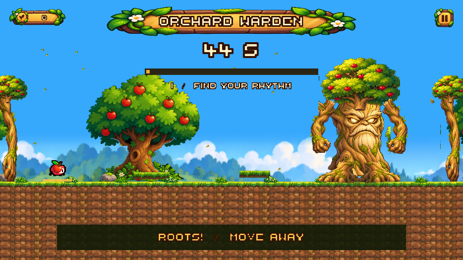

# Orchard Warden — первое испытание Apple Meadow

Первый мир теперь заканчивается боем на выживание с живой древней яблоней. Это светлый золотистый страж сада с красными яблоками в кроне, двигающимися ветвями, корнями и глазами. Игрок побеждает, когда переживает **45 секунд активного боя**. После этого дерево опускает ветви, закрывает глаза и пропускает Appi дальше.

## Игровой цикл

Существующий длинный маршрут Apple Meadow → небольшая безопасная дорожка → чекпоинт с флажком → яблоко у входа на арену → вступление → 45 секунд уклонения → отдых стража → завершение мира → Continue в доступный Deceptive Forest либо Lobby.

Рычаг, камень, старые платформы и квадратный прототип удалены из финальной арены Tutorial. Оружия, запаса палок и шкалы HP у этого испытания нет. Прежний прототип сохранён отдельно в `BossTest.unity`; рабочая сцена нового первого босса — **`MeadowBossTest.unity`**.

## Сцены и ассеты

| Путь внутри Assets/_Trapple | Назначение |
|---|---|
| `Scenes/Levels/Tutorial.unity` | Настоящий первый мир с новой ареной после прежнего маршрута |
| `Scenes/BossArenas/MeadowBossTest.unity` | Короткая отдельная сцена новой арены для работы с боссом |
| `Prefabs/OrchardWarden/OrchardWarden.prefab` | Новый переиспользуемый составной страж |
| `Art/OrchardWarden/OrchardKit.png` | Исходная графика, созданная встроенным imagegen |
| `Art/OrchardWarden/*.asset` | Шесть Sprite Assets с нативными мешами деталей |
| `Settings/HubConfiguration.asset` | Прежняя общая конфигурация: имя Orchard Warden и завершение через босса |

Арена полностью перестроена: широкая поляна с травой и почвой, яблони и камни, два низких корневых уступа, видимые живые границы, летающие золотистые листья. Глубина почвы покрывает кадр при обычных соотношениях сторон. До входа босс остаётся спящим и не атакует.

Новая графика получена встроенным `image_gen`; точный prompt и путь исходника — [ArtPrompt.md](ArtPrompt.md). Unity-сборщик создаёт Sprite-меши вокруг нужных прозрачных островов, чтобы обрывки соседних деталей атласа не появлялись рядом с персонажем. Исходный PNG не изменяется.

## Поведение и повторное использование

`MeadowBossEncounter` остаётся владельцем первого боя: Route → Intro → Fighting → Resolving → Complete либо Failed. Он управляет камерой, таймером, чекпоинтом и завершением мира. `TutorialGoal` по-прежнему передаёт вход в encounter и объявляет уровень пройденным после его развязки.

Анимации и атаки переиспользуют `ForestGuardianController`, `ForestGuardianAnimation` и пул `ForestGuardianHazard`. В prefab первого босса установлен **survivalOnly = true**: здоровье не открывает уязвимость, а повреждение не может запустить победу. У Forest Guardian второго мира этот режим по умолчанию выключен; его бой палками и по времени сохраняется.

Атаки первого стража настроены мягче:

- **Root Strike**: предупреждение фиксирует позицию игрока, затем появляются корни. Нужно уйти с отмеченного места.
- **Branch Slam**: страж замахивается и бьёт только в ближней области. Дальняя часть арены остаётся безопасной.
- **Leaf Storm**: два листа летят горизонтально с предсказуемой скоростью. Их можно перепрыгнуть.

Предупреждение — 1,3 секунды; паузы между атаками — 2,1–2,8 секунды; скорость листьев — 5. Во время подготовки следующей атаки остатки прежних опасных объектов очищаются. При смерти или победе пул также очищается.

Риг использует плавную боевую стойку, перенос веса, движение ветвей и корней, моргание, вступление, замахи и удар. По таймеру проигрывается Retreat: страж устаёт и засыпает. Корневой объект с коллайдером сохраняет своё положение; двигаются его визуальные детали.

## UI и UX

Перед ареной появляется короткое объяснение испытания. Вступление длится 4,5 секунды и показывает имя, цель и управление; **Enter** пропускает его и корректно возвращает управление.

Во время боя видны:

- Крупное название **ORCHARD WARDEN** на баннере в стиле существующего Storybook UI.
- Большой обратный отсчёт **45 s**, размер шрифта 128.
- Золотая плавная шкала уже пережитого времени.
- Три временные отметки испытания: Find your rhythm / Keep moving / Almost there.
- Контекстная подсказка перед атакой: **ROOTS! MOVE AWAY**, **BRANCH! STEP BACK**, **LEAVES! JUMP**.

Шкала означает время испытания, а не здоровье. В последние 10 секунд отсчёт меняет цвет. Общая подсказка WATCH YOUR STEP скрывается у арены, чтобы не закрывать таймер. Счётчика оружия здесь нет.

Для паузы и смерти используется существующий интерфейс GameManager/DeathScreenUI. Новый HUD скрывается во время этих состояний. Его кнопки завершения существуют в активном UI только после победы: они не мешают вводу и не перехватывают навигацию экрана смерти.

После победы открывается крупный WORLD COMPLETED / APPLE MEADOW с Continue и Lobby. Использованы существующие художественные кнопки и окно, стандартные серые Unity-кнопки не добавлялись.

## Чекпоинт и сохранение

Флажок перед ареной сохраняет временный чекпоинт по пути сцены. При Respawn прежний экран смерти перезагружает уровень, затем Appi возвращается к флажку с полным временем и свежим состоянием босса. Бой не начинается до нового входа на арену; вступление снова можно пропустить.

Таймер работает только в состоянии Fighting, пока Appi жив, GameManager.State == Playing и Time.timeScale > 0. Во вступлении, паузе и во время смерти он не продвигается. Смерть у нулевой границы не засчитывается как победа.

Временный чекпоинт очищается при победе или переходе в другую сцену. Долгосрочное завершение использует прежние `WorldCompletion.Record("meadow", scenePath)` и `PreviewProgressionService` с ключом `Trapple.HubPreview.v1`. Записываются уровень, обучение и босс; карта миров получает прежний индикатор завершения. Continue запускает существующий настроенный лес. Новая система файлов сохранения не создавалась.

## Настройки Inspector

| Компонент | Поля |
|---|---|
| MeadowBossEncounter | survivalDuration = 45, introDuration = 4.5, resolutionDuration = 2.7, arenaBounds, checkpointPosition, cameraPosition, cameraSize, ссылки на камеру/игрока/босса/цель |
| ForestGuardianController на OrchardWarden | survivalOnly = true, minimumAttackInterval = 2.1, maximumAttackInterval = 2.8, warningDuration = 1.3, leafSpeed = 5, leafWaves = 2, длительности атак и спрайты |
| ForestGuardianAnimation | части рига, скорость стойки, амплитуда, скорость смешивания |
| MeadowBossHUD | группы интерфейса, таймер, шкала, подсказки и кнопки |
| GuardianLeaves | ссылка meadow, границы и заранее созданные листья |

Для воспроизводимой подготовки есть пункт **Trapple → Boss progression → Rebuild Orchard Warden survival trial**, метод `Trapple.Editor.MeadowBossBuilder.Build`. Он пересоздаёт только объект `Meadow boss encounter` и связанные ссылки в Tutorial, сохраняет сцену через Unity Editor API и создаёт короткую тестовую сцену. Прежний маршрут до арены сохраняется. Ручные правки внутри генерируемой арены следует переносить в builder/prefab перед следующей пересборкой.

## Самостоятельная проверка

1. Открыть `MeadowBossTest.unity`, нажать Play, подойти к флажку и яблоку.
2. Прочитать вступление, повторить с пропуском Enter и паузой Escape.
3. Уклоняться A/D и Space, проверить три предупреждения и крупный отсчёт.
4. Погибнуть, нажать Respawn: проверить возврат к флажку, исходные 45 секунд и отсутствие старых атак.
5. Прожить 45 секунд: проверить отдых стража и экран победы.
6. В реальном Tutorial пройти маршрут и бой, нажать Continue: должен загрузиться Deceptive Forest; на карте при возврате в хаб первый мир отмечается пройденным.
7. Перезапустить приложение и проверить сохранение. Победа в `MeadowBossTest` сама по себе не записывается в production-конфигурацию миров.

Результаты автоматической проверки и сборки находятся в [Validation.md](Validation.md). Человеческая оценка сложности, ощущения камеры и читаемости при игре остаётся отдельным ручным playtest.

