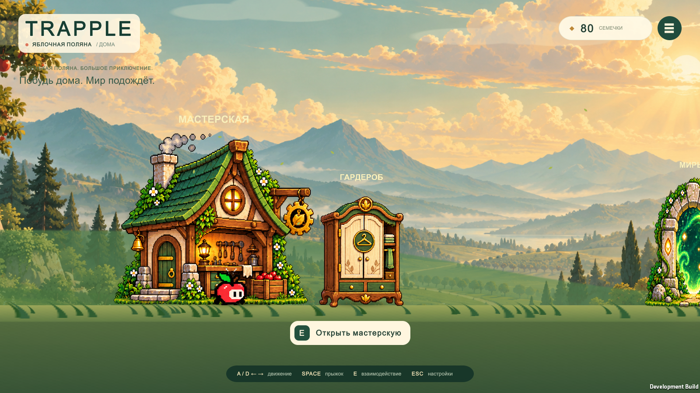
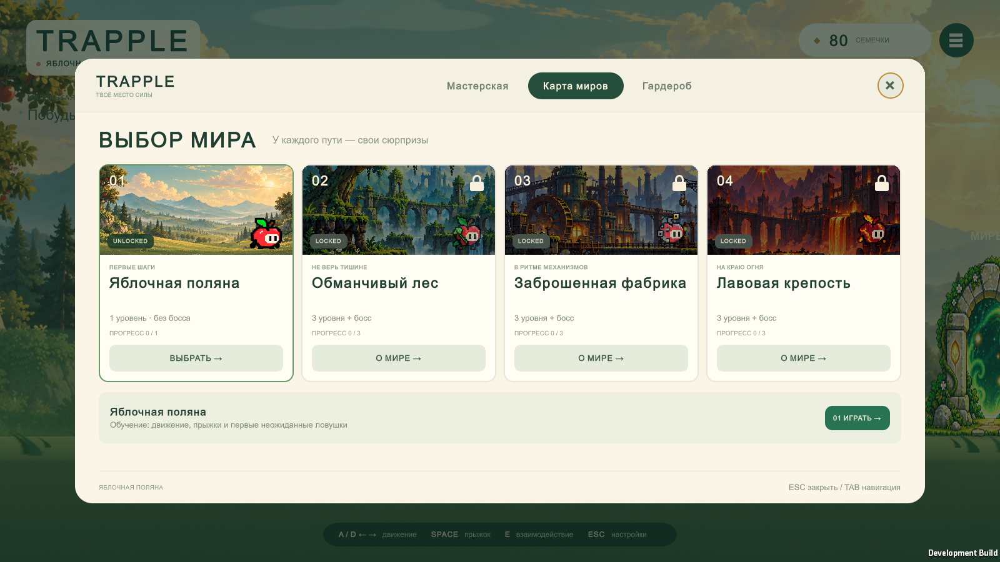
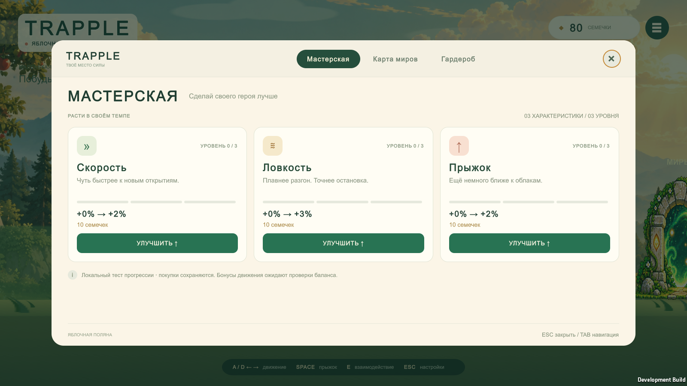
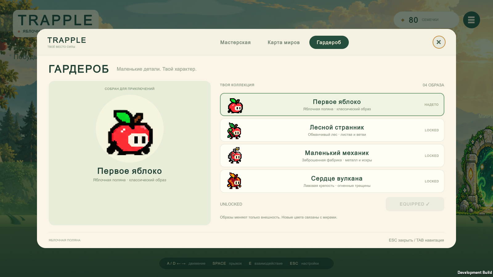

# Pixel art and keyboard update

Implemented and validated on **2026-10-22**, using **Unity 6000.6.0f1** on Windows.
Branch: `fix/hub-pixel-assets-and-input`, based on Hub commit `b6e732d`.
The original Hub PR [#5](https://github.com/bekw-eg/Trapple/pull/5) was still open
when this follow-up was prepared. The PR targeting `main` therefore includes that
Hub implementation as well as this update. Neither PR was merged by the agent.

## Applied changes

- Replaced the workshop, wardrobe and portal with the supplied pixel designs,
  extracted onto transparency. Replaced Forest/Factory/Lava world illustrations
  with native sprite rectangles from the supplied composite image.
- Used the supplied transparent **Appi Apple Sprite Animation Sheet.png** directly:
  4 idle frames, 6 walking right, 6 walking left and 4 jump/landing poses.
  The yellow sheet is retained as reference. Appi pixels were not regenerated.
- Added `PlayerAnimationSet` and a presentation-only `PlayerSpriteAnimator`.
  It selects frames from existing velocity and ground contact. Foot pivots align
  the character to the existing collider; textures use Point filtering.
- Updated the shared player prefab, so Hub, Tutorial and the boss test arena
  inherit the new Appi appearance. PlayerController, collider dimensions,
  movement parameters, level scenes and boss behavior were not changed.
- Fixed the settings button retaining focus after a modal closed. Gameplay
  navigation-submit/Space events can no longer activate that HUD button.
  Escape opens settings during Hub gameplay and closes any open Hub window.
  Normal keyboard navigation and purchase submission inside modals still work.

The transparent Appi source and its repository copy both have SHA-256:

```text
577D6E9E9C1F8234BE7EAA6881EC54EFA93942424AF4A179A066BA82309E3208
```

Unity Editor APIs generated the scene, prefabs, sprite metadata and configuration.
The scene diff includes regenerated Unity object IDs. No scene YAML was authored
by hand. The complete follow-up file inventory is in [PixelUpdateFiles.md](PixelUpdateFiles.md).
Artwork sources and the transparent-prop extraction prompt are recorded in
[HubArtSources.md](HubArtSources.md).

## Verification

| Check | Result |
| --- | --- |
| C# compilation and Hub regeneration in Unity | Passed |
| Windows development player build | Passed |
| EditMode suite | **10 / 10 passed**, no failures/skips |
| Full PlayMode suite, including Tutorial and boss regressions | **36 / 36 passed**, no failures/skips |
| New HUD submit/Escape/focus restoration regression | Passed |
| New right/left walking, rising/falling and modal idle animation regression | Passed |
| Windows player: five screens at 1920×1080, 1600×900 and 1366×768 | Passed |
| Purchases, maximum upgrade, insufficient funds, Tutorial completion and Hub return | Passed |
| Final capture runtime log | No errors or exceptions |

The Windows smoke run produced **18 screenshots**. Its recorded result was:

```text
PASS — 3 resolutions, 5 screens, upgrades, Tutorial completion and return
```

Representative updated captures:






NUnit XML, build log and full captures are stored locally in the ignored
`Logs/PixelUpdate/` directory. The tested Windows executable is available locally
at `Builds/Hub/Trapple.exe`. Binaries, logs and Unity caches are excluded from Git.
Validation used an isolated project copy, preserving the existing Editor session.

## Remaining verification and limits

- Native keyboard testing through computer-use could not start: its Windows
  helper returned `Computer Use native pipe is unavailable` / `os error 2`,
  including after retry and kernel reset. No actual keyboard presses were
  delivered. The passing automated regression dispatches real UI Toolkit submit
  events and invokes the Escape handler; it does not verify OS input delivery or
  replace a human keyboard/mouse playthrough. A development-only
  `-hub-keyboard-check <output-folder>` probe is available for Space, Esc, Esc,
  Space verification when a native input session is available.
- Background extraction of the three pixel props used image generation and may
  differ in individual edge pixels. Appi frames and world-card image pixels use
  the supplied PNGs directly. The original meadow backdrop remains in place.
- The three world-linked cosmetic previews retain their earlier static sprites;
  the supplied animation set applies to the base Appi appearance.
- No dodge, combat, new levels, audio, production economy or movement-upgrade
  integration was added. Existing Hub preview limitations are in [Hub.md](Hub.md).
- Non-Windows builds and native keyboard/mouse feel were not tested.
