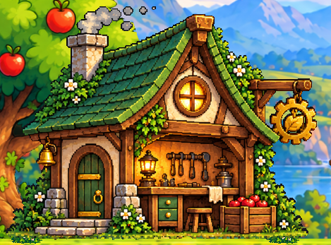
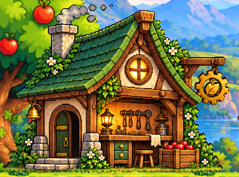
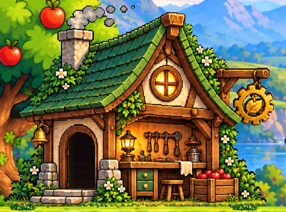

# Исправление двери в Apple Meadow Lobby

Дата: 23 октября 2026. Ветка: `feature/apple-meadow-lobby-integration`.

При интеграции лобби фасад был заменён спрайтом из нового атласа, в котором уже
нарисована закрытая дверь. Девять анимационных кадров рисовались поверх неё:
после открытия оставалась видна вторая закрытая дверь. Кроме того, положение и
масштаб оверлея были заданы в мировых координатах вместо координат исходного фасада.

## Исправление

- В Hub и TrappleUI восстановлен прежний `Workshop/Door/house_empty_doorway.png`.
- Сохранён `CottageCutout.mat`: фон вокруг здания прозрачен, внутри проёма остаётся
  непрозрачная темнота.
- Дверь использует прежние `doors_png/door_00.png` — `door_08.png` без изменения
  пикселей, порядка или скорости 10 FPS.
- Оверлей снова привязан к исходному холсту 469×347: локальное смещение
  `(-1.035, -0.845, 0)`, локальный масштаб `(1, 1, 1)`, без дополнительного поворота.
  Здание и дверь масштабируются вместе с сохранением исходных пропорций.
- Фокус приближения камеры и последняя точка прохода перенесены к фактическому
  проёму. Начальная точка подхода/выхода сохранена.
- Установщик Apple Meadow использует эту же привязку при последующем применении
  оформления и проверяет сочетание фасада, материала и оверлея перед сохранением.

Обе сцены пересохранены через Unity Editor API. Прочие объекты оформления не
пересоздавались. Исходные изображения двери, их метаданные и общий префаб мастерской
не изменены.

## Проверки

- Два новых регрессионных теста сначала воспроизвели ошибку на прежних сценах:
  вместо пустого фасада был назначен `InteractablesAtlas.png`.
- После исправления полный EditMode: **28/28**, без ошибок и пропусков. Проверены
  также обе сохранённые сцены, привязка оверлея, исходные девять кадров, материал,
  пропорции и положение фокуса/последней точки прохода.
- Исправление применено дважды в отдельной проверочной копии проекта.
- Unity D3D11 отрисовал все девять состояний настоящей сохранённой сцены Hub.
  Пиксели вне исходного кропа двери `(91,198,80,120)` одинаковы во всех состояниях.
  При полном открытии контрольная точка внутри проёма имеет RGB `(15,10,9)`:
  это тёмный интерьер исходного фасада, а не нарисованная зелёная дверь.

- PlayMode: **25/25**, без ошибок и пропусков — HubTests, WorkshopTests и
  WorkshopDoorTests. В том числе открытие/закрытие по всем девяти индексам,
  неподвижность фасада, 10 FPS при нулевом timeScale, сброс/разворот, вход,
  выход и восстановление управления.
- Windows development build: **Success**.
- Собранный Windows D3D11-плеер: **PASS** — вход, выход, восстановление физики/
  управления и повторный вход/выход через существующий проверочный сценарий.
  Локальный `Builds/Hub/Trapple.exe` обновлён из проверенной сборки.

Локальные XML и логи находятся в игнорируемом `Builds/DoorRepairReview/`.
Чтение видео и сравнение кадров не изменяло исходные файлы пользователя.

## Рендеры Unity

Закрыта:

Промежуточный кадр:

Открыта:

## Изменённые файлы

- `Assets/_Trapple/Editor/AppleMeadowLobbyBuilder.cs`.
- `Assets/_Trapple/Scenes/Hub/Hub.unity`.
- `Assets/_Trapple/Scenes/Menu/TrappleUI.unity`.
- `Assets/_Trapple/Tests/EditMode/WorkshopDoorAssetTests.cs`.
- `Docs/AppleMeadowLobbyIntegration.md`.
- `Docs/Validation/AppleMeadowDoorRepair.md`.
- `Docs/Images/AppleMeadowDoorRepair/Closed.png`.
- `Docs/Images/AppleMeadowDoorRepair/Middle.png`.
- `Docs/Images/AppleMeadowDoorRepair/Open.png`.

## Ограничения

Сохранены прежние девять кадров: открытие сжимает изображение створки, отдельные
перспективные рисунки для каждого угла не добавлялись. Маска фасада рассчитана на
UV полного исходного холста; здание не следует упаковывать в атлас с изменением UV.
Другие платформы и Render Pipeline в этой задаче не проверялись.
